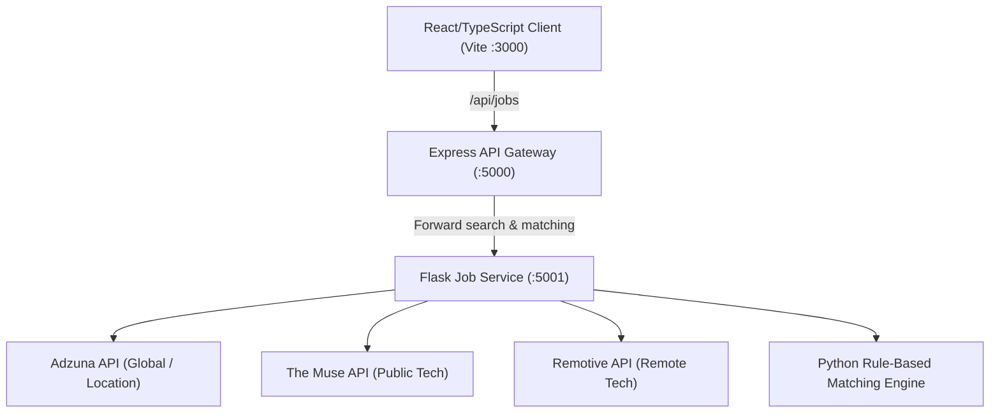

# GigSync — Python Flask Job Search & Resume Matching Service

A dedicated Python Flask REST microservice powering real, location-based job discovery and honest, evidence-grounded resume matching for the GigSync Career Preparation Platform.

---

## 1. Architecture Overview

GigSync integrates a multi-tier dual backend architecture:
- **Frontend:** React 18 + TypeScript + Vite (`client/`)
- **API Gateway & Core Services:** Node.js / Express (`server/` and Vercel serverless function `/api`)
- **Job Search & Matching Service:** Python 3.10+ Flask Service (`backend/flask_service/`)
- **External Real Providers:**
  1. **Adzuna API:** Authorized global job search provider supporting country-specific routing (`in`, `us`, `gb`, `ca`, `au`, `de`, `fr`, etc.) with user-supplied credentials.
  2. **The Muse API:** Legitimate public corporate job board for verified software engineering listings.
  3. **Remotive API:** Legitimate public tech API for remote engineering opportunities with location eligibility checks.



---

## 2. API Endpoints

### `GET /api/jobs`
Query real, location-filtered job postings.

#### Parameters:
| Parameter | Type | Required | Description | Example |
|---|---|---|---|---|
| `role` / `keyword` | string | Optional | Job title or target technical domain | `Python Developer` |
| `location` | string | Optional | City, state, or country name | `Bengaluru, India` |
| `work_mode` | string | Optional | `Remote`, `Hybrid`, `On-site`, or `All` | `Hybrid` |
| `experience_level` | string | Optional | `Internship`, `Entry-level`, `Junior`, or `All` | `Entry-level` |
| `skills` | string | Optional | Comma-separated list of target skills | `Python,Docker,PostgreSQL` |
| `page` | integer | Optional | 1-indexed page number (default: `1`) | `1` |
| `limit` | integer | Optional | Max items per page (1-50, default: `20`) | `20` |

#### Sample Response:
```json
{
  "jobs": [
    {
      "id": "adzuna_4892019",
      "source": "Adzuna",
      "sourceJobId": "4892019",
      "title": "Python Backend Developer",
      "company": "Infosys Ltd",
      "location": "Bengaluru, Karnataka, India",
      "workMode": "Hybrid",
      "experienceLevel": "Entry-level",
      "salaryRange": "₹750,000 - ₹1,100,000 / year",
      "description": "Designing high-scale Python microservices with FastAPI and PostgreSQL...",
      "requirements": {
        "essentialSkills": ["Python", "FastAPI", "SQL", "Git"],
        "preferredSkills": ["Docker", "Kubernetes", "AWS"],
        "constraints": ["Eligible to work in India"],
        "minYearsExperience": 0
      },
      "postedAt": "2026-10-28T14:30:00Z",
      "applyUrl": "https://www.adzuna.in/details/4892019",
      "verified": true
    }
  ],
  "total": 1,
  "page": 1,
  "filters": {
    "role": "Python Developer",
    "location": "Bengaluru, India",
    "work_mode": "Hybrid",
    "experience_level": "Entry-level"
  },
  "message": null
}
```

---

### `GET /api/jobs/<job_id>`
Retrieves full details for a previously cached or referenced job.

---

### `POST /api/match` (or `POST /api/jobs/match`)
Calculates honest, transparent matching between candidate profile evidence and job requirements.

#### Scoring Formula (PRD Section 7.2):
- **Skills (50%):** Essential requirements (70%) + Preferred requirements (30%)
- **Experience (25%):** Practical experience / internships / project complexity
- **Education (15%):** Degree and STEM/CS alignment
- **Role Match (10%):** Target title similarity

#### Guarantees:
- Resumes with 0 skills receive **0% skills score** (no artificial baseline).
- Missing information is categorized as unknown, never assumed as proof.
- Does not present scores as hiring probabilities.

---

### `GET /api/health`
Healthcheck endpoint displaying service readiness and active providers.

---

## 3. Environment Configuration (`.env`)

Copy `backend/flask_service/.env.example` to `backend/flask_service/.env` (or root `.env`):

```bash
FLASK_PORT=5001
FLASK_HOST=0.0.0.0
FLASK_DEBUG=false

# Allowed CORS Origins
CORS_ORIGINS=http://localhost:3000,http://localhost:5000,https://gigsync-platform.vercel.app

# Real Job Provider Credentials:
ADZUNA_APP_ID=your_adzuna_app_id_here
ADZUNA_APP_KEY=your_adzuna_app_key_here
THE_MUSE_API_KEY=optional_key_for_higher_rate_limits
```

---

## 4. Local Development

### 1. Install Python dependencies:
```bash
pip install -r backend/flask_service/requirements.txt
```

### 2. Run the Flask Service:
```bash
python backend/flask_service/app.py
# Running on http://127.0.0.1:5001
```

### 3. Run the Node.js Express Gateway:
```bash
npm run build:server
npm run start:server
# Running on http://localhost:5000 (proxies /api/jobs to Flask :5001)
```

### 4. Run the Vite Client:
```bash
cd client && npm run dev
# Running on http://localhost:3000
```

---

## 5. Production Deployment

### Option A: Containerized / Cloud Service (Render / Railway / Fly.io / AWS ECS)
Deploy `backend/flask_service/` as a container or WSGI application using Gunicorn:
```bash
gunicorn --bind 0.0.0.0:$PORT backend.flask_service.app:app --workers 4 --timeout 120
```
Set environment variables:
- `ADZUNA_APP_ID`
- `ADZUNA_APP_KEY`
- `CORS_ORIGINS=https://gigsync-platform.vercel.app`

Configure the Express server / Vercel deployment with:
- `FLASK_SERVICE_URL=https://your-flask-service.onrender.com`

---

## 6. Running Tests

Run the comprehensive pytest suite:
```bash
pytest backend/flask_service/tests/test_jobs_api.py -v
```
All 10 unit and live provider integration tests should pass:
- Valid search parameters
- Location and work-mode filters
- Empty search results (without fake jobs)
- Provider authentication failure
- Provider timeout handling
- Invalid query parameters
- Absence of fabricated fallback jobs
- Real profile resume matching
- Zero-skill profile resume matching
- Live provider integration
